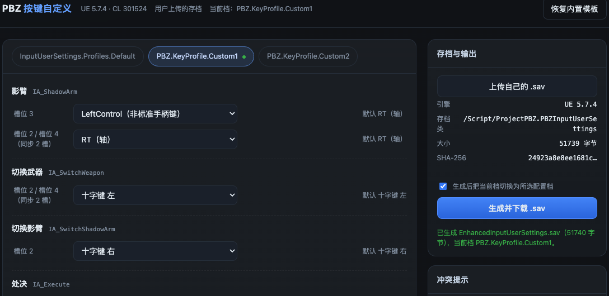

# PBZ 手柄按键自定义工具 · 使用说明

一个本地小工具：在浏览器里点选 Xbox / PS5 手柄按键，重新生成
`EnhancedInputUserSettings.sav`，用来替换游戏里的手柄键位。

- 默认编辑配置档：**Custom1**
- 默认把游戏当前配置档切换为 **Custom1**
- 不改角色进度，不改其他存档，只在本地运行

---

## 1. 系统要求

- Windows 10/11、macOS 或 Linux
- Python 3.8 或更高版本（无第三方库）
- 任意现代浏览器（Chrome / Edge / Firefox / Safari）

Windows 如果没有 Python，请先到 <https://www.python.org/downloads/> 安装，
安装时勾选 **Add Python to PATH**。

---

## 2. 快速开始

### Windows

在本工具目录空白处按住 Shift + 右键，选择“在此处打开 PowerShell / 终端”，执行：

```bat
py -3 app.py
```

如果没有 `py`，改用：

```bat
python app.py
```

### macOS / Linux

```bash
cd 工具目录
python3 app.py
```

启动后浏览器会自动打开 <http://127.0.0.1:8765>。
如果没有自动打开，手动在浏览器输入这个地址即可。

停止工具：在终端按 `Ctrl + C`。

端口被占用时可以换一个：

```bash
python3 app.py --port 9000
```

---

## 3. 使用步骤

界面预览：



1. **先备份**你游戏里现有的
   `EnhancedInputUserSettings.sav`（见第 5 节）。
2. 启动工具，页面默认载入内置模板。
3. 顶部选择配置档，默认是 **Custom1**。
4. 每个动作的每个槽位用下拉框选择按键；右侧显示该动作的原始默认键。
5. 同一动作、当前键相同的多个槽位会合并成一行（例如轻攻击的“槽位 2 / 4 / 6”），
   修改这一行会同步写入这些槽位。
6. 保持“生成后把当前档切换为所选配置档”勾选（默认已勾选）。
7. 点 **生成并下载 .sav**，浏览器会下载 `EnhancedInputUserSettings.sav`。
8. 完全退出游戏，用下载的文件替换游戏里的同名文件（见第 4 节）。
9. 重新进入游戏，确认使用的是 **Custom1** 配置档。

> 如果你已经在游戏里改过键，建议先点“上传自己的 .sav”，载入你当前的存档，
> 工具会在你的文件基础上修改，而不是覆盖成内置模板。

---

## 4. 生成的文件放哪里

把下载得到的 `EnhancedInputUserSettings.sav` 放到：

```
<游戏根目录>\ProjectPBZ\Saved\EnhancedInputUserSettings.sav
```

Steam 用户可以在库中右键游戏 → **管理** → **浏览本地文件**，进入游戏根目录后
按上面的路径找到 `ProjectPBZ\Saved\`。

注意：

- 只替换 **`EnhancedInputUserSettings.sav` 这一个文件**。
- 不要替换整个 `Saved` 文件夹，不要动其他 `.sav`。
- 文件名必须保持 `EnhancedInputUserSettings.sav`，不要改名。
- 替换前请完全退出游戏，否则会被游戏覆盖。
- 如果找不到 `ProjectPBZ\Saved\`，先运行一次游戏再退出，让游戏生成该文件夹。

---

## 5. 备份与还原

替换前，把原来的文件复制到游戏目录之外保存，例如：

```
EnhancedInputUserSettings.sav.bak
```

还原时：

1. 完全退出游戏。
2. 把备份文件改回 `EnhancedInputUserSettings.sav`，放回原路径。
3. 重启游戏。

> 没有备份也可以在游戏里恢复默认键位，但无法找回你之前的个人按键。

---

## 6. 功能说明

### 配置档

游戏里有多套手柄配置档，工具默认编辑 **Custom1** 并把它设为当前档。
你也可以在顶部切换到 Default / Custom2 再编辑。

### 槽位合并与同步

同一个动作可能有多个“槽位”（First～Sixth），是 UE Enhanced Input 的多绑定机制。
工具会把 **同一动作、当前键相同** 的槽位合并显示为一行，例如：

```
轻攻击    槽位 2 / 4 / 6（同步 3 槽）    [X]
```

修改这一行会同时写入这三个槽位。若你把同一动作的两行改成同一个键，它们会自动合并。
这样就不会出现“只改了一个槽、动作还在响应旧键”的情况。

### 冲突提示

同一按键绑定到多个 **不同动作** 时会提示，例如 A 同时用于跳跃和交互。
提示不会阻止生成，因为这类冲突是允许的，实际优先级由游戏自身逻辑决定。
同一动作的多个槽位不会误报。

### 上传自己的存档

点“上传自己的 .sav”，选择你游戏目录里的
`ProjectPBZ\Saved\EnhancedInputUserSettings.sav`，工具会基于你的文件修改。

### 当前配置档

勾选“生成后把当前档切换为所选配置档”后，生成的存档会把
`CurrentProfileIdentifierString` 设为所选档，进游戏即生效。

---

## 7. 支持范围

### 手柄

- 键名按手柄物理位置命名，Xbox 与 PS5 手柄通用：
  - PS5 的 ×/○/□/△ 对应 A/B/X/Y 的位置
  - L1/R1/L2/R2 对应 LB/RB/LT/RT
  - L3/R3 对应左/右摇杆按下
- 界面目前使用 Xbox 名称（A/B/X/Y）显示。

### PS5 专属配置档

- 内置模板只有 `Family = Xbox` 的配置档。
- 如果你用 PS5 手柄进游戏并改过键，游戏生成了 PlayStation 档，上传该存档后工具可以识别并编辑它。
- 工具目前不能凭空创建 PS5 专属档，因为需要游戏实际使用的 Family 名称。

### 长按 / 组合键

工具只能修改“已存在动作用哪个键”，不能新增长按判定、组合键或“按键 + 方向”条件。
例如“点按左摇杆蹲下、长按 + 方向冲刺”中的长按与方向组合属于游戏资源逻辑，
无法只靠这份存档实现。

---

## 8. 安全与校验

- 工具只监听本机 `127.0.0.1`，不会把文件上传到网络。
- 输入文件只读，生成在内存中完成，输出通过浏览器下载。
- 生成时会重新计算所有父级数据长度，并在写盘前自检：
  - 输出文件可完整解析；
  - 重复序列化字节一致；
  - 目标档改动生效；
  - 其他配置档逐条完全一致。
- 自检失败会直接报错，不产出文件。

---

## 9. 常见问题

**双击/命令运行没反应？**
确认已安装 Python，并在工具目录执行 `py -3 app.py` 或 `python3 app.py`。

**浏览器没有自动打开？**
手动访问 <http://127.0.0.1:8765>。

**生成按钮提示“文件结构不支持”？**
说明存档版本与工具不匹配。请上传你游戏实际生成的
`EnhancedInputUserSettings.sav` 再试；仍失败说明该版本结构不同，工具不会强行改写。

**替换后游戏里没变化？**
依次检查：游戏是否完全退出、是否替换到正确路径、文件名是否正确、
是否在游戏里选中 Custom1、Steam Input / DS4Windows 是否又做了一层重映射。

**为什么轻攻击有三个槽位？**
这是 UE 的多槽位机制，同一动作可存多条绑定。工具已把它们合并显示并同步修改。

**Default / Custom2 里影臂槽位 3 是 LeftControl？**
这是原始存档里的键盘残留值，工具会原样保留；需要的话在界面里手动改掉。

---

## 10. 已知限制

- 仅支持与本工具模板同结构的存档（UE 5.7.4，`ProjectPBZ.PBZInputUserSettings`）。
- 只处理手柄按键；不处理键盘映射，也不修改尾部 EnhancedInput 对象与显示名。
- 不修改默认键（`DefaultKey`），只改每条绑定的当前键。
- 未在游戏中实测输入优先级，只保证文件结构与字段正确。
- 建议只保留一层手柄映射（Steam Input 或 DS4Windows 二选一），避免双重映射。

---

## 11. 发布包内容

```
pbz_keymap/
  README.md              ← 本文件
  app.py                 ← 本地服务入口
  gvas.py                ← 存档解析/序列化
  keymap.py              ← 按键模型与校验
  static/index.html      ← 网页界面
  assets/EnhancedInputUserSettings.sav  ← 内置模板
  示例截图.png           ← 界面示例图片
```

玩家只需要解压整个 `pbz_keymap` 文件夹，按第 2 节运行即可。

---

## English Quick Start

1. Install Python 3.8+.
2. Run `py -3 app.py` (Windows) or `python3 app.py` (macOS/Linux).
3. Open <http://127.0.0.1:8765>, pick **Custom1**, remap buttons, click
   **生成并下载 .sav**.
4. Fully exit the game, then replace
   `<game root>\ProjectPBZ\Saved\EnhancedInputUserSettings.sav` with the downloaded file.
5. Back up your original file first. Only replace that one file.

Default profile: **Custom1**. The tool also sets the current profile to Custom1.